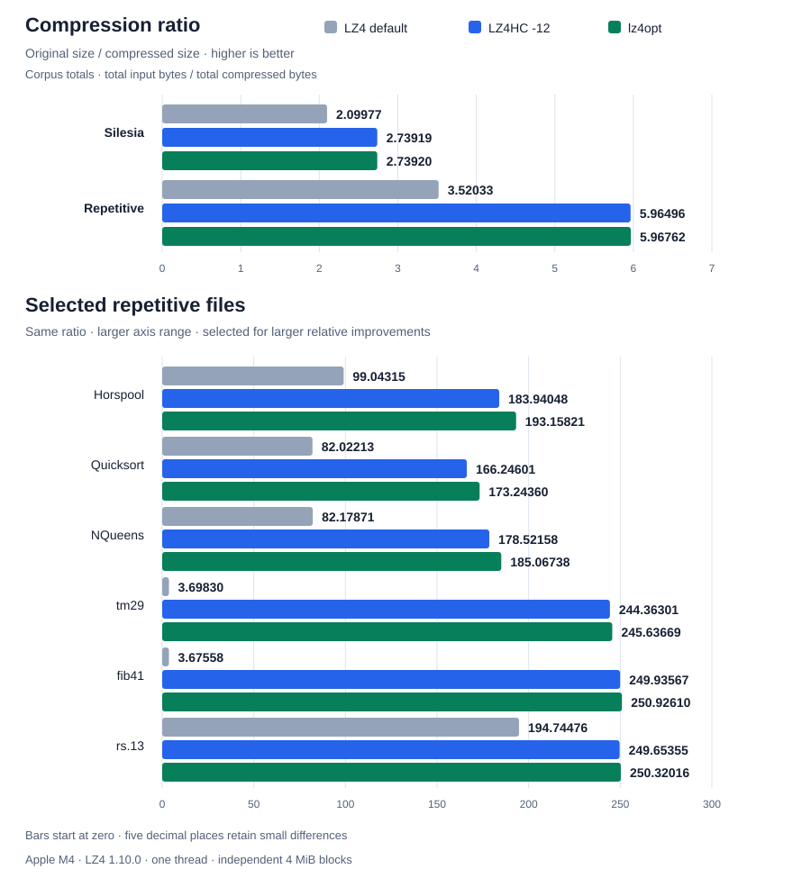

# lz4opt

An optimal LZ4 encoder, written in Rust.
By default, it produces the smallest output that the LZ4 format allows for each block, and it writes standard LZ4 frames that the official `lz4` tool decodes.

The [official LZ4 encoder](https://github.com/lz4/lz4) does not search every candidate for the longest match: it skips or truncates the search to stay fast, so its output is not guaranteed to be optimal.
lz4opt always computes the longest match with the sliding suffix tree of [snakree](https://github.com/kg86/snakree).
The optimal parser then chooses the cheapest sequence of literals and matches, which guarantees optimality.
The greedy parser (`-parser greedy`) takes the longest match at every position and does not guarantee optimality.
The optimal parser runs in O(n) time and O(n) memory per block.
The paper [lz4opt-en.pdf](docs/paper/lz4opt-en.pdf) explains the algorithm this implementation is based on and proves this bound, and [docs/lz4/README.md](docs/lz4/README.md) describes the code.

This implementation is a proof of concept for understanding LZ4 better, not a practical tool: it does not aim to match the speed of the official encoder, and the experiments below compare the sizes it reaches with the official levels.

Besides the encoder, the crate contains tools to inspect LZ4 frames as JSON and a greedy LZ77 (including LZ76) encoder with a simple container format.
LZ77 is the scheme on which LZ4 is based.
All of it uses only the public API of `snakree`.

## LZ4 encoding

The `lz4` module ([details](docs/lz4/README.md)) supports independent 64 KiB, 256 KiB, 1 MiB, or 4 MiB blocks (default), a content checksum, and uncompressed fallback when compression does not reduce the payload size.
The parser is selected with `-parser greedy|optimal` and defaults to `optimal`.

```sh
cargo run --release --bin lz4opt < input > output.lz4
cargo run --release --bin lz4opt -- -parser greedy < input > output.lz4
lz4 -dc output.lz4 > restored
```

This repository provides only an LZ4 encoder and has no LZ4 decoder.
To decode the frames it writes, use the official `lz4` tool (`lz4 -dc`), as above.

## Experimental results

Compared with official LZ4 1.10.0, lz4opt shows that `-12` already comes very close to the minimum size on these corpora, with more room for improvement on some highly repetitive files.
The default level (`-1`) is included as the baseline most users run.
All encoders used one thread and independent 4 MiB blocks with the same block boundaries; all outputs were decoded with official LZ4 and checked against the inputs.

| Corpus | Encoder | Compressed size (bytes) ↓ | Speed (MiB/s) ↑ |
| --- | --- | ---: | ---: |
| [Silesia](https://sun.aei.polsl.pl/~sdeor/index.php?page=silesia) (12 files, ~202 MiB) | LZ4 default (`-1`) | 100,934,427 | 631.0 |
| Silesia | LZ4HC `-12` | 77,372,720 | 15.8 |
| Silesia | **lz4opt** | **77,372,438** | 4.4 |
| Repetitive (29 files, ~5.3 GiB) | LZ4 default (`-1`) | 1,620,776,282 | 1,004.4 |
| Repetitive | LZ4HC `-12` | 956,532,249 | 9.2 |
| Repetitive | **lz4opt** | **956,106,286** | 8.9 |

On Silesia, lz4opt saves just **282 bytes** in total, with identical sizes on 6 of the 12 files.
It takes about 3.6 times as long to compress, with peak RSS of 359.9 MiB versus 14.2 MiB for `-12`.
The default level is about 140 times faster than lz4opt on Silesia, but its output is about 30% larger than `-12`.
On the repetitive corpus its output is about 69% larger, and it is about 110 times faster.
On the [Pizza&Chili repetitive corpus](https://pizzachili.dcc.uchile.cl/repcorpus.html), it saves **425,963 bytes** overall at a similar aggregate speed; individual files show larger relative improvements.



The grouped bars compare compression ratios, defined as original size divided by compressed size (higher is better), following the convention used in the official LZ4 benchmark table.
The values are printed beside each bar.
The top chart uses total input bytes divided by total compressed bytes for each corpus; the bottom chart highlights six repetitive files with larger relative improvements.
Both axes start at zero, but the bottom chart uses a larger range; labels show five decimal places to retain small differences.
For example, lz4opt makes `Horspool` about **4.77% smaller** than `-12`.
Expanding the official parser's optimization range (`LZ4_OPT_NUM`) from 4,096 to 65,536 reduces the remaining gap to **12 bytes on Silesia** and **25,947 bytes on the repetitive corpus**, but increases compression time on some files.

These measurements were taken on 2026-11-08 on an Apple M4 with 32 GiB RAM; Silesia timings use the median of three runs per file, and repetitive-corpus timings use one run per file.
See [experiments/lz4](experiments/lz4/README.md) for the comparison methodology and reproduction steps.

## LZ4 frames as JSON

To inspect an encoded frame as JSON, use the `lz4::framejson` module or the `lz4frame-json` command:

```sh
cargo run --release --bin lz4opt < input > output.lz4
cargo run --release --bin lz4frame-json -- inspect output.lz4 > output.json
cargo run --release --bin lz4frame-json -- restore output.json restored.lz4
cmp output.lz4 restored.lz4
```

The JSON records frame fields and compressed-block sequences with byte offsets.
See the [schema and limitations](docs/lz4frame-json/README.md) for details.

## Online LZ77 parsing

The `lz77` module ([format and API](docs/lz77/README.md)) builds greedy LZ77 phrases online from the tree's longest repeated suffix, and the `lz77` command encodes and decodes streams in a simple documented format:

```sh
cargo run --release --bin lz77 -- encode -window 4096 input > output.lz77
cargo run --release --bin lz77 -- decode output.lz77 > restored
```

### LZ76 compression

With an unbounded window and no copy length limit, the greedy parse is the LZ76 parse, so `lz77 encode` is an LZ76 compressor.
See [LZ76 compression](docs/lz77/README.md#lz76-compression) for usage, the complexity measure, and memory use.

## Other programs

`bench` times the encoders and `scripts/bench-compare.py` compares two revisions with it; `matchbench`, `framestats` and `lz77stats` are experiment tools.
See [docs/benchmarking.md](docs/benchmarking.md) for benchmarking.

## Tests

```sh
cargo fmt --check
cargo clippy --all-targets -- -D warnings
cargo test --release
```

Interoperability tests against the official `lz4` command-line tool skip with a message when it is not installed.
They also read `testdata/sample.txt`.
See [DEVELOPMENT.md](DEVELOPMENT.md) for local API documentation setup.

## Citation

If you use lz4opt in academic work, please cite it.
GitHub shows the citation under "Cite this repository", which reads [CITATION.cff](CITATION.cff).
The BibTeX entry is:

```bibtex
@software{goto_lz4opt,
  author  = {Goto, Keisuke},
  title   = {lz4opt: an optimal {LZ4} encoder},
  year    = {2026},
  version = {0.1.0},
  url     = {https://github.com/kg86/lz4opt}
}
```

## License

MIT.
See [LICENSE](LICENSE).
